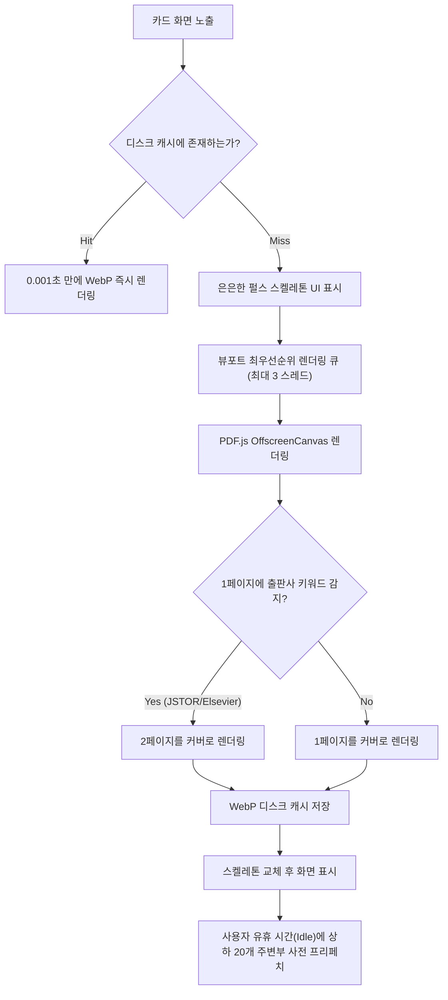

# [RFC/PRD] Zotero 10 Cover Grid Extension Technical Specification

> **프로젝트명**: `zotero-cover-grid`  
> **초기 릴리즈 버전**: `v0.1.0`  
> **라이선스**: MIT License  
> **문서 상태**: Ultimate Locked (v4.0 Unattended /goal Ready)  
> **타깃 플랫폼**: macOS Zotero 10.0+ (`Gecko 140.15.0 ESR`, XUL+XHTML 런타임 단일 타깃)  
> **개발 스택**: TypeScript 5+, esbuild, Web Components, PDF.js v5.7, Vitest, Gecko 140 Web APIs  
> **목적**: 자율 에이전트(`/goal` 모드)가 무인(Unattended) 상태에서 단 한 번의 중단 없이 100% 빌드, 패키징, 동작 검증을 완주할 수 있는 최종 구현 명세.

---

## 1. Visual Reference & UI 디자인 시스템

### 1.1 디자인 레퍼런스
사용자가 확정한 APA 7 학술 카드 레이아웃 & 줌 슬라이더 인터페이스:


### 1.2 핵심 UI 레이아웃 사양
```
┌────────────────────────────────────────────────────────────────────────┐
│ [Zotero 툴바] [검색창...] [🔍 줌 슬라이더] [목록뷰 [≡] | 그리드뷰 [⊞] (Active)]  │
├────────────────────────────────────────────────────────────────────────┤
│ [#zotero-items-pane 컨테이너 (flex=1)]                                  │
│  ├── <html:div id="zotero-items-tree" hidden="true">...</html:div>     │
│  └── <html:zotero-cover-grid id="zotero-cover-grid">                   │
│                                                                        │
│       ┌──────────────────────┐    ┌──────────────────────┐             │
│       │ ┌──────────────────┐ │    │ ┌──────────────────┐ │             │
│       │ │  PDF First Page  │ │    │ │  PDF First Page  │ │             │
│       │ │  Cover Thumbnail │ │    │ │  Cover Thumbnail │ │             │
│       │ │  (3:4 Aspect)    │ │    │ │  (3:4 Aspect)    │ │             │
│       │ └──────────────────┘ │    │ └──────────────────┘ │             │
│       │ Kim et al. (2026)    │    │ Lee et al. (2025)    │             │
│       │ APA 7 · Article      │    │ APA 7 · Article      │             │
│       │ [ Reading ] (Click)  │    │ [ Read ]    (Click)  │             │
│       └──────────────────────┘    └──────────────────────┘             │
│                                                                        │
│  </html:zotero-cover-grid>                                             │
└────────────────────────────────────────────────────────────────────────┘
```

- **XHTML 네임스페이스 엄수**: `document.createElementNS("http://www.w3.org/1999/xhtml", "zotero-cover-grid")` 사용.
- **2D 반응형 그리드 & 줌 슬라이더**:
  - `ResizeObserver`로 컨테이너 너비를 감지하여 `columns = Math.floor(width / cardWidth)` 동적 계산.
  - 상단 툴바의 줌 슬라이더로 카드 크기(140px ~ 320px) 실시간 조절.
- **카드 규격 (Card Specs)**:
  - 표지 비율: 고정 **3:4 비율** (`aspect-ratio: 3 / 4`).
  - 호버 인터랙션: 툴팁 없이 미니멀한 그림자 호버 애니메이션만 적용 (`transform: translateY(-4px)`, 부드러운 박스 섀도우 확대).
  - 1행: `저자 (연도)` APA 7 표기 표준 (`font-weight: 600`, 13px, 1줄 말줄임):
    - 1명: `Kim (2026)`
    - 2명: `Kim & Lee (2026)`
    - 3명 이상: `Kim et al. (2026)`
  - 2행: `APA 7 · Item Type` (11px, 회색조).
  - 3행: `[Reading]` / `[Read]` / `[Unread]` 읽기 상태 배지:
    - **원클릭 순환 토글**: 뱃지 클릭 시 `[읽기 전] ➔ [읽는 중] ➔ [읽음]` 즉시 순환 변경.
    - **신호등 컬러 팔레트**:
      - `Unread`: Muted Gray (밝은 테마 `#f3f4f6`, 텍스트 `#4b5563` / 다크 테마 `#374151`, 텍스트 `#9ca3af`)
      - `Reading`: Warm Amber (밝은 테마 `#fef3c7`, 텍스트 `#d97706` / 다크 테마 `#78350f`, 텍스트 `#fde68a`)
      - `Read`: Emerald Green (밝은 테마 `#d1fae5`, 텍스트 `#059669` / 다크 테마 `#064e3b`, 텍스트 `#6ee7b7`)
    - Zotero 공식 태그(`#reading`, `#read`, `#unread`)와 양방향 자동 동기화.
  - 다크 모드 융합: A4 용지 눈부심 방지를 위해 `filter: brightness(0.9) contrast(1.05)` 적용.

- **Zotero 네이티브 설정 존중 대원칙 (Respect Native Preferences)**:
  - **PDF 뷰어 선택 존중**: 더블클릭 시 Zotero 자체의 `openPDFIn` 설정(내장 탭 vs 시스템 기본 뷰어)을 그대로 미러링하여 실행 (`ZoteroPane.openAttachment()`).
  - **삭제(Delete) 정책 존중**: `Delete` 키 입력 시 `ZoteroPane.deleteSelectedItems()`를 호출하여 컬렉션에선 '폴더에서 제외', 내 서재에선 '휴지통으로 이동', `Cmd+Delete`는 '영구 삭제'라는 Zotero 고유 정책을 100% 그대로 유지.
  - **폰트 크기 설정 상속**: Zotero 고급 설정의 '글자 크기(작게/보통/크게)' 변경 시 카드의 텍스트 폰트 크기도 Zotero 시스템 CSS 변수(`var(--default-font-size)`)를 상속받아 일체감 있게 자동 리사이징.
  - **스위처 인터랙션**: 기존 Zotero 글로벌 단축키 충돌 방지를 위해 단축키 없이 **상단 툴바 세그먼트 버튼 클릭으로만 100% 안전하게 전환**.
  - **위치**: 검색창 바로 우측에 `[ ≡ 목록 | ⊞ 바둑판 ]` 형태의 일체형 세그먼트 버튼(Segmented Toggle)으로 직관적 배치.
  - **다국어(Fluent .ftl)**: 영어(`en-US`)와 한국어(`ko-KR`) 2개 공식 지원 (추가 언어는 오픈소스 커뮤니티 PR로 확장).
  - **하위 폴더(Subcollection) 정책**: Zotero의 자체 `extensions.zotero.recursiveCollections` 설정을 100% 존중하여 동일하게 동작.
  - **빈 서재(Empty State)**: 아이템이 0개인 빈 컬렉션에서는 잡다한 일러스트 없이 극도의 **미니멀한 빈 배경 유지**.

---

## 2. 인터랙션 & 키보드 내비게이션 (Full UX Specs)

1. **마우스 인터랙션**:
   - **단일 클릭**: Zotero 우측 인스펙터 서지정보 패널 즉시 동기화.
   - **더블 클릭**: Zotero 내장 PDF 리더 새 탭으로 즉시 열기 (`Zotero.Reader.open(attachment.id)`).
   - **우클릭 컨텍스트 메뉴**: Zotero 네이티브 메뉴(`zotero-itemmenu`)를 그대로 상속하여 항목 내보내기/삭제 등을 지원하되, 최상단에 `[이 표지 새로고침]`, `[2페이지를 표지로 설정]` 커스텀 액션 주입.
   - **다중 선택**: `Cmd/Ctrl + 클릭` (개별 토글 선택), `Shift + 클릭` (연속 범위 선택), 좌측 컬렉션 폴더로 일괄 드래그 앤 드롭 이동 지원.
2. **키보드 내비게이션 (마우스리스 탐색)**:
   - 방향키(`↑`, `↓`, `←`, `→`): 카드 포커스 이동 시 **우측 서지정보 인스펙터가 실시간으로 함께 갱신**.
   - `Enter`: 선택된 카드의 PDF 리더 열기.
3. **검색(Search) 인터랙션**:
   - Zotero 상단 검색창에 키워드 입력 시, **매칭되는 논문만 남기고 그리드를 실시간으로 즉시 재배열** (0ms 딜레이).
4. **정렬 순서 (Sorting)**:
   - Zotero 기존 리스트 뷰의 정렬(최신순/제목순/저자순)을 **100% 그대로 미러링** (`ZoteroPane.itemsView.rowProvider`).
5. **PDF 없는 논문**:
   - 제목·저자가 타이포그래피된 그라데이션 가상 표지 렌더링 + 클릭 시 'PDF 자동 찾기' 연동.

---

## 3. 핵심 엔진: 지능형 썸네일 & 2단계 캐시 파이프라인

### 3.1 "Zero-Freeze" 썸네일 생성 파이프라인


1. **스켈레톤 로딩 (Skeleton Loading)**:
   - 썸네일이 준비되지 않은 카드는 은은한 펄스 애니메이션이 흐르는 스켈레톤 뷰 표시.
2. **스마트 출판사 스플래시 페이지 감지**:
   - 1페이지 텍스트에서 `Downloaded from`, `JSTOR`, `ResearchGate`, `Terms of Use` 감지 시 자동으로 **2페이지를 커버로 렌더링**.
   - 카드 우클릭 시 `[표지 페이지 변경 (1p / 2p)]` 제공.
3. **상하 20개 지능형 프리페치 (Idle Prefetch)**:
   - 사용자 유휴 시간(`requestIdleCallback`)에 현재 뷰포트 바로 위아래 20개 항목을 백그라운드 사전 생성하여 스크롤 시 0초 로딩 보장.
4. **다중 첨부파일 중 '본문 PDF' 자동 판별**:
   - `item.getBestAttachment()` 기반으로 판별하되, 파일명에 `supplement`, `appendix`, `si`, `supporting`이 포함된 부록 PDF는 후순위로 미루고 실제 본문 PDF를 최우선으로 커버 추출.
5. **캐시 관리 & 유지보수 (Storage & Purge)**:
   - Zotero 상단 메뉴 `[도구 ➔ Cover Grid 설정]`에 "캐시 용량 확인" 및 "전체 캐시 비우기" 제공.
   - 개별 카드 우클릭 메뉴에 `[이 표지 새로고침]` 기능 제공.
   - 메모리 누수 방지: 컴포넌트 언마운트/퇴출 시 `URL.revokeObjectURL(blobUrl)` 및 `pdfDoc.destroy()` 강제.

---

## 4. 빌드 시스템 & 무인 자율 실행(`/goal`) 필수 명세

자율 에이전트가 `/goal` 실행 시 단 한 번의 에러 없이 통과할 수 있도록 고정된 표준 환경 설정입니다.

### 4.1 `package.json`
```json
{
  "name": "zotero-cover-grid",
  "version": "0.1.0",
  "description": "Visual APA 7 Cover Grid view for Zotero 10 (Gecko 140 ESR)",
  "main": "build/addon/bootstrap.js",
  "type": "module",
  "scripts": {
    "build": "node scripts/build.mjs",
    "package": "node scripts/build.mjs --prod && node scripts/make-xpi.mjs",
    "type-check": "tsc --noEmit",
    "lint": "tsc --noEmit",
    "test": "vitest run",
    "clean": "node -e \"import('fs').then(fs => fs.rmSync('build', { recursive: true, force: true }))\""
  },
  "devDependencies": {
    "@types/node": "^20.14.0",
    "archiver": "^7.0.1",
    "esbuild": "^0.24.0",
    "typescript": "^5.5.4",
    "vitest": "^2.0.5",
    "zotero-types": "^1.1.20"
  }
}
```

### 4.2 `scripts/build.mjs` (XPCOM Scope Trapping 방지 필수 번들러)
```javascript
import esbuild from 'esbuild';
import fs from 'node:fs';
import path from 'node:path';

const isProd = process.argv.includes('--prod');
const outDir = 'build/addon';

fs.mkdirSync(outDir, { recursive: true });
if (fs.existsSync('addon')) {
  fs.cpSync('addon', outDir, { recursive: true });
}

await esbuild.build({
  entryPoints: ['src/bootstrap.ts'],
  bundle: true,
  format: 'iife',
  globalName: '__ZoteroCoverGridExport__',
  outfile: path.join(outDir, 'bootstrap.js'),
  target: ['firefox128', 'es2022'], // Gecko 140 ESR 호환
  minify: isProd,
  sourcemap: !isProd ? 'inline' : false,
  footer: {
    // XPCOM 최상위 전역 스코프에 4대 생명주기 함수 노출 필수
    js: 'var { install, startup, shutdown, uninstall } = __ZoteroCoverGridExport__;'
  },
  external: [
    'resource://*',
    'chrome://*'
  ],
  logLevel: 'info',
});

console.log(`[build.mjs] Compiled bootstrap.js (${isProd ? 'prod' : 'dev'})`);
```

### 4.3 `addon/manifest.json` & `scripts/make-xpi.mjs`
```json
{
  "manifest_version": 2,
  "name": "Zotero Cover Grid",
  "version": "0.1.0",
  "description": "Visual APA 7 Cover Grid view with smart PDF caching for Zotero 10",
  "icons": {
    "48": "icons/icon-48.png"
  },
  "browser_specific_settings": {
    "zotero": {
      "id": "zotero-cover-grid@antigravity.user",
      "strict_min_version": "10.0",
      "strict_max_version": "10.*"
    }
  }
}
```

```javascript
// scripts/make-xpi.mjs
import fs from 'node:fs';
import path from 'node:path';
import archiver from 'archiver';

const sourceDir = 'build/addon';
const distDir = 'build';
const outPath = path.join(distDir, 'zotero-cover-grid.xpi');

if (!fs.existsSync(path.join(sourceDir, 'manifest.json')) || !fs.existsSync(path.join(sourceDir, 'bootstrap.js'))) {
  throw new Error('[make-xpi] CRITICAL: manifest.json or bootstrap.js missing in build/addon!');
}

const output = fs.createWriteStream(outPath);
const archive = archiver('zip', { zlib: { level: 9 } });

output.on('close', () => {
  console.log(`[make-xpi] Generated XPI: ${outPath} (${(archive.pointer() / 1024).toFixed(1)} KB)`);
});

archive.on('error', (err) => { throw err; });
archive.pipe(output);
// 아카이브 최상위 루트(/)에 파일 압축
archive.directory(sourceDir, false);
await archive.finalize();
```

### 4.4 도메인 인터페이스 (`src/types/index.ts`)
```typescript
export type ReadStatus = 'unread' | 'reading' | 'read';

export interface PaperCardData {
  id: number;
  key: string;
  title: string;
  authorText: string;     // e.g. "Kim et al. (2026)" (APA 7 표준)
  citationText: string;   // e.g. "APA 7 · Journal Article"
  itemType: string;
  year: string;
  readStatus: ReadStatus;
  hasPdf: boolean;
  bestAttachmentId?: number;
  coverThumbnailUrl?: string;
}

export interface IThumbnailCacheManager {
  getThumbnail(item: any): Promise<string>;
  saveThumbnail(itemKey: string, blob: Blob): Promise<string>;
  clearCache(): Promise<void>;
  refreshThumbnail(item: any): Promise<string>;
}
```

---

## 5. 단계별 태스크 & 무인 헤드리스 인수 조건 (DoD)

CLI 무인 환경의 에이전트가 통과 여부를 직접 판정하는 헤드리스 커맨드 기준:

### Step 1: Scaffolding & Build System
- [ ] `package.json`, `tsconfig.json`, `scripts/build.mjs`, `scripts/make-xpi.mjs` 구성.
- [ ] `addon/manifest.json` 및 `src/bootstrap.ts` 엔트리포인트 생성.
- **인수 조건 (DoD)**:  
  `npm run type-check && npm run package` 실행 성공 및 `build/zotero-cover-grid.xpi`가 생성되고, ZIP 루트에 `manifest.json`과 `bootstrap.js`가 정상 포함됨을 자동 검증.

### Step 2: XHTML 네임스페이스 UI 주입 & 무손실 스위칭
- [ ] `document.createElementNS("http://www.w3.org/1999/xhtml", ...)`로 커스텀 엘리먼트 주입.
- [ ] `#zotero-items-pane` 내부에서 `zotero-items-tree`와 `zotero-cover-grid`의 `hidden` 속성 상호 전환.
- [ ] 툴바에 [목록형 [≡] | 그리드형 [⊞]] 세그먼트 버튼 및 [🔍 줌 슬라이더] 주입.
- **인수 조건 (DoD)**:  
  `npx vitest run tests/dom-lifecycle.test.ts` 통과 (DOM 주입 및 무손실 스위칭 상태 머신 검증).

### Step 3: PDF.js 썸네일 파이프라인 & 지능형 캐시 매니저
- [ ] `resource://zotero/reader/pdf/build/pdf.mjs` 기반 썸네일 생성 모듈 구현.
- [ ] 출판사 스플래시 페이지(JSTOR, Elsevier 등) 감지 시 자동 2페이지 커버 렌더링 구현.
- [ ] 스켈레톤 로딩 UI 컴포넌트 및 유휴 시간(Idle) 상하 20개 프리페치 큐 구현.
- [ ] `IOUtils`를 통한 WebP 디스크 캐시 및 `URL.revokeObjectURL()` 메모리 회수 처리.
- **인수 조건 (DoD)**:  
  `npx vitest run tests/splash-detector.test.ts tests/cache-manager.test.ts` 통과 (스플래시 감지 및 WebP 캐시 해싱 파이프라인 무인 검증).

### Step 4: 2D 가상 스크롤, APA 7 카드 & 다중 선택 & 키보드
- [ ] `ResizeObserver` 기반 2D 가상 스크롤러 구현 (최대 40개 DOM 노드 재활용).
- [ ] APA 7 포맷터(1명/2명/3명이상) 및 읽기 상태 뱃지(`Reading` / `Read`) 렌더링.
- [ ] 읽기 상태 뱃지 클릭 시 `[읽기전 ➔ 읽는중 ➔ 읽음]` 원클릭 순환 토글 & Zotero 태그 동기화.
- [ ] `Cmd/Ctrl` 및 `Shift` 다중 선택 구현 & 컬렉션 드래그 앤 드롭 바인딩.
- [ ] 방향키(`↑↓←→`) 포커스 이동 시 우측 서지정보 실시간 갱신 & `Enter`로 PDF 열기.
- **인수 조건 (DoD)**:  
  `npx vitest run tests/apa-formatter.test.ts` 통과 (APA 7 포맷터 100% 일치 및 순환 토글 태그 바인딩 검증).

### Step 5: 통합 테스트, CI/CD 및 폴리싱
- [ ] 검색창 타이핑 시 실시간 그리드 필터링 및 재배열 검증.
- [ ] 다크 모드 톤다운 필터 적용 검증.
- [ ] 줌 슬라이더 조절 시 실시간 카드 리사이징 검증.
- [ ] GitHub Actions CI/CD 워크플로우(`.github/workflows/release.yml`) 작성 (태그 푸시 시 `.xpi` 자동 빌드 및 Release 첨부).
- [ ] 최종 README.md 및 설치 가이드 작성.
- **인수 조건 (DoD)**:  
  `npm run test && npm run type-check && npm run package` 전체 파이프라인 일괄 통과 (Exit Code 0).
