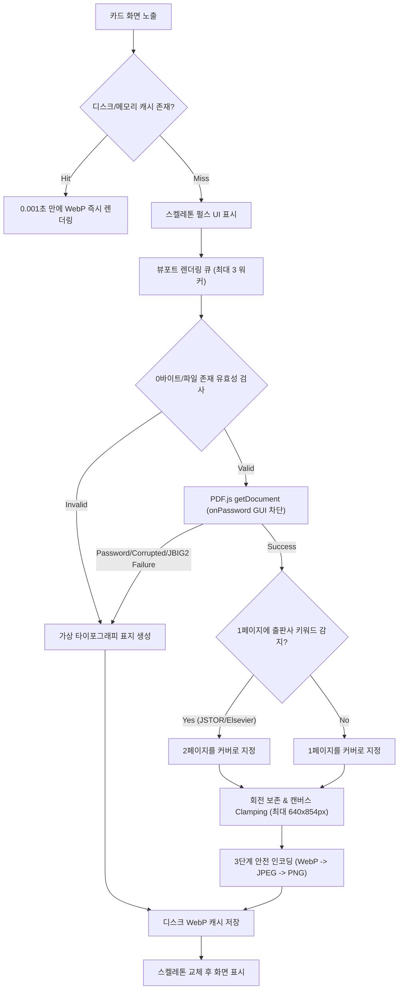

# [Technical Specification] Zotero Cover Grid Extension

> **프로젝트명**: `zotero-cover-grid`  
> **현재 버전**: `v0.4.2`  
> **라이선스**: MIT License  
> **타깃 플랫폼**: Zotero 7 & 10+ (`Gecko 115 ~ 140+ ESR`, XUL+XHTML 통합 환경)  
> **개발 스택**: TypeScript 5+, esbuild, Web Components, PDF.js, Vitest (happy-dom), Gecko Web APIs  

---

## 1. 개요 및 설계 원칙

본 확장기능은 Zotero의 텍스트 중심 논문 목록을 직관적인 **바둑판(그리드) 서가 뷰**로 전환하여 학술 연구자의 시각적 탐색 효율을 극대화합니다.

### 3대 핵심 원칙
1. **순정 Zotero 조작감 100% 보존 (Native Parity UX)**:
   - 뷰만 바둑판으로 변경될 뿐, 검색, 단축키, 다중 선택, 색상 태그(0~9), 드래그 앤 드롭, 서지 인스펙터 패널 등 기존 Zotero의 모든 조작 체계를 그대로 유지합니다.
2. **Zero-Lag & Zero-Freeze 렌더링**:
   - 가상 스크롤(Virtual Scrolling), WebP 디스크 캐싱, 비동기 디바운스, 상하 주변부 지능형 프리페치를 통해 수천 편 규모의 라이브러리에서도 60fps 탐색을 보장합니다.
3. **무결점 런타임 호환성 (Zero Crash & Safe Fallback)**:
   - 손상된 파일, 암호화된 PDF, 0바이트 파일, 구형 스캔본(JBIG2/Type1 폰트) 등 어떠한 예외 상황에서도 크래시 없이 가상 타이포그래피 표지로 안전하게 폴백합니다.

---

## 2. UI 레이아웃 & 디자인 시스템

### 2.1 인터페이스 구성
```
┌────────────────────────────────────────────────────────────────────────┐
│ [Zotero 툴바] [검색창...] [🔍 줌 슬라이더] [목록뷰 [≡] | 그리드뷰 [⊞] (Active)]  │
├────────────────────────────────────────────────────────────────────────┤
│ [#zotero-items-pane 컨테이너 (<hbox flex="1">)]                        │
│  ├── <html:div id="zotero-items-tree" hidden="true">...</html:div>     │
│  └── <html:zotero-cover-grid id="zotero-cover-grid">                   │
│       │                                                                │
│       ├── .grid-viewport (overflow-y: auto, flex: 1 1 0%)              │
│       │    ┌──────────────────────┐    ┌──────────────────────┐        │
│       │    │ ┌──────────────────┐ │    │ ┌──────────────────┐ │        │
│       │    │ │  PDF First Page  │ │    │ │  PDF First Page  │ │        │
│       │    │ │  Cover Thumbnail │ │    │ │  Cover Thumbnail │ │        │
│       │    │ │  (3:4 Aspect)    │ │    │ │  (3:4 Aspect)    │ │        │
│       │    │ └──────────────────┘ │    │ └──────────────────┘ │        │
│       │    │ Kim et al. (2026)    │    │ Lee et al. (2025)    │        │
│       │    │ APA 7 · Article      │    │ APA 7 · Article      │        │
│       │    │ [ Reading ] (Click)  │    │ [ Read ]    (Click)  │        │
│       │    └──────────────────────┘    └──────────────────────┘        │
│                                                                        │
│  </html:zotero-cover-grid>                                             │
└────────────────────────────────────────────────────────────────────────┘
```

### 2.2 레이아웃 & 뷰포트 CSS 규칙
- **Gecko XUL `<hbox>` 0px 높이 붕괴 방지**:
  - `#zotero-cover-grid`는 `display: flex !important; flex-direction: column !important; flex: 1 1 0% !important; height: 100% !important;`를 준수.
  - `[hidden]` 속성 활성화 시 `display: none !important;`로 덮어써 완벽히 은닉.
- **반응형 2D 가상 서가 (140px ~ 340px 줌)**:
  - 툴바 슬라이더로 카드 폭을 실시간 조절 (`--card-width` CSS 변수 연동, 3열~8열).
- **표지 카드 사양**:
  - 종횡비: **3:4 고정 비율** (`aspect-ratio: 3 / 4`, `object-fit: contain` 레터박스).
  - 1행: `저자 (연도)` APA 7 표기 (1명: `Kim (2026)`, 2명: `Kim & Lee (2026)`, 3명+: `Kim et al. (2026)`).
  - 2행: `APA 7 · Item Type` (11px 메타 텍스트, 1줄 말줄임).
  - 3행: `[Reading]` / `[Read]` / `[Unread]` 읽기 상태 배지 (원클릭 순환 토글, `#unread`/`#reading`/`#read` 태그와 실시간 양방향 동기화).

---

## 3. 마우스 & 키보드 인터랙션 명세

| 입력 / 단축키 | 상세 동작 |
| :--- | :--- |
| **클릭** | 카드 선택 및 우측 서지정보(인스펙터) 패널 즉시 동기화 |
| **더블클릭 / Enter** | 내장 PDF 리더(또는 기본 뷰어) / 연구 노트 새 탭 열기 |
| **방향키 (↑, ↓, ←, →)** | 마우스 없는 카드 포커스 이동 및 뷰포트 자동 추적 스크롤 (`scrollIntoView`) |
| **Shift + 방향키** | 인접 카드 연속 범위 다중 확장 선택 |
| **Cmd / Ctrl + 클릭** | 개별 카드 다중 선택 (토글) |
| **Shift + 클릭** | 연속 범위 카드 다중 선택 |
| **Cmd / Ctrl + C** | Zotero 기본 퀵 카피(Quick Copy) 인용 클립보드 복사 |
| **숫자키 (0 ~ 9)** | Zotero 공식 네이티브 색상 태그(Color Tags) 지정 및 해제 (`Zotero.Tags.toggleItemsListTags`) |
| **좌측 컬렉션 드래그** | 카드를 사이드바 컬렉션 폴더로 끌어놓아 즉시 분류 (`text/x-zotero-drag-item`) |
| **우클릭 / Control+클릭** | Zotero 순정 컨텍스트 메뉴 표출 (노트 카드는 노트 전용 액션으로 자동 분기) |
| **Backspace** | 현재 컬렉션에서 항목 제외 (라이브러리 보존) |
| **Cmd+Backspace / Shift+Del** | 라이브러리 휴지통으로 항목 이동 |
| **검색창 입력 / ESC** | 150ms 디바운스 실시간 검색 필터링 (`ESC` 시 즉시 전체 서재 복원) |
| **좌측 하단 태그 창 클릭** | 태그 다중 선택 시 그리드 실시간(0ms) 반응형 필터링 |

---

## 4. 핵심 아키텍처 & 파이프라인

### 4.1 지능형 썸네일 생성 파이프라인


### 4.2 4대 그래픽 엣지 케이스 방어
1. **캔버스 치수 Clamping (Canvas Dimension Clamp)**:
   - A0 포스터 등 초대형 PDF(2384x3370pt) 렌더링 시 VRAM 폭발 방지 (`MAX_CANVAS_WIDTH = 640`, `MAX_CANVAS_HEIGHT = 854`).
2. **손상/암호화/0바이트 파일 큐 기아(Deadlock) 차단**:
   - `onPassword` GUI 팝업을 차단하고 즉시 가상 타이포그래피 표지로 안전 폴백.
3. **3단계 다단계 안전 인코딩**:
   - `OffscreenCanvas.convertToBlob({ type: 'image/webp' })` $\rightarrow$ 실패 시 `image/jpeg` $\rightarrow$ 최종 실패 시 `image/png`.
4. **지능형 프리페치 (Idle Prefetch)**:
   - `requestIdleCallback`을 통해 가시 뷰포트 상하 20개 항목을 백그라운드에서 사전 생성.

### 4.3 컬렉션 데이터 무손실 동기화 (Data Parity)
- **SQLite DB + `itemsView` 통합 소스**:
  - 컬렉션 조회 시 Zotero SQLite `collectionItems` 테이블과 현재 창의 `zp.itemsView.getSortedItems()`를 우선 소스로 직접 연동하여 단독 PDF, 구형 논문, 메타데이터 미정리 항목의 누락을 100% 방지.
- **Scroll Anchoring & Stable Keying**:
  - 클라우드 동기화 중 상단에 새 논문이 추가되어도 상단 앵커 카드의 위치를 추적하여 `scrollTop` 델타 보정 (스크롤 튐 0px).
  - 카드 DOM 노드를 `Map<itemID, HTMLElement>`로 재사용하여 깜빡임 없는 인플레이스 갱신.
- **AbortController 큐 플러시**:
  - 좌측 컬렉션 변경 즉시 이전 컬렉션의 모든 썸네일 대기열과 비동기 작업을 중단하고 새 컬렉션 로딩으로 전환.

---

## 5. 모듈 구조

```
src/
├── bootstrap.ts                    # XPCOM 부트스트랩 엔트리포인트 (startup/shutdown)
├── types/                          # 도메인 모델, Gecko XPCOM 및 환경 앰비언트 타입
├── utils/                          # APA 7 포맷터, 리치 텍스트 파서, 클립보드 유틸
├── thumbnail/                      # PDF.js 렌더링 엔진, 출판사 Splash 감지, 디스크/메모리 캐시
├── sync/
│   ├── window-controller.ts        # 창별 컨트롤러 인스턴스
│   ├── collection/                 # SQLite DB & itemsView 컬렉션 페처
│   ├── filter/                     # 150ms 디바운스 검색 & 태그 필터 엔진
│   ├── tags/                       # Zotero 네이티브 색상 태그(0~9) 및 읽기 상태 동기화
│   └── notifier/                   # Zotero.Notifier 이벤트 브로드캐스트 핸들러
└── ui/
    ├── virtual-scroller.ts         # 60fps 가상 스크롤 뷰포트
    ├── tab-view.ts                 # 탭 뷰 래퍼
    ├── context-menu.ts             # 순정 컨텍스트 메뉴 연동 및 노트 커스텀 액션
    ├── toolbar/                    # 세그먼트 스위처 [≡|⊞], 줌 슬라이더, 뷰 전환 동기화
    └── card/                       # 3:4 표지 카드 컴포넌트 & 제스처/트랙패드 핸들러
```

---

## 6. 품질 검증 및 테스트 규격

- **테스트 환경**: Vitest + happy-dom (Gecko 115 ~ 140+ XPCOM 모의 환경)
- **테스트 현황**: **32개 테스트 파일 / 211개 테스트 100% 통과**
- **품질 게이트 (CI/CD)**:
  - `npm run type-check`: TypeScript 엄격 모드 0 에러
  - `npm test`: 211개 단위·통합·엣지케이스 테스트 통과
  - `npm run package`: 프로덕션 번들링 및 `build/zotero-cover-grid.xpi` 무결성 패키징
