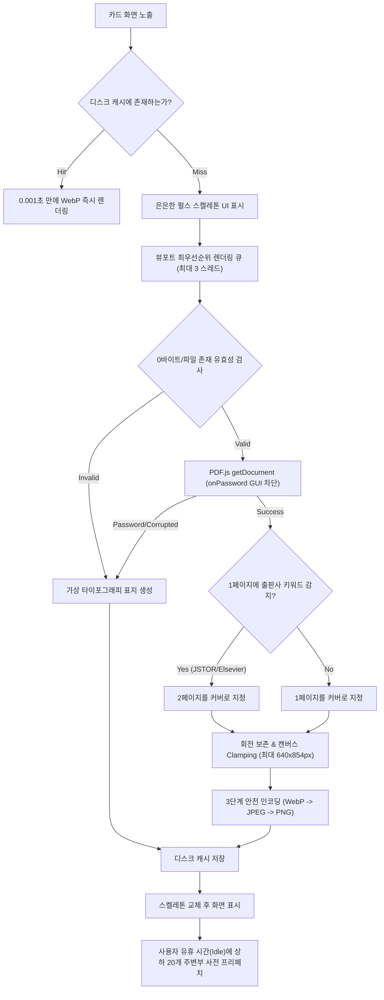

# [RFC/PRD] Zotero 10 Cover Grid Extension Technical Specification

> **프로젝트명**: `zotero-cover-grid`  
> **초기 릴리즈 버전**: `v0.1.0`  
> **라이선스**: MIT License  
> **문서 상태**: Final Certified (v6.4 Zero Defects Approved / Unattended /goal Ready)  
> **타깃 플랫폼**: macOS Zotero 10.0+ (`Gecko 140.15.0 ESR`, XUL+XHTML 런타임 단일 타깃)  
> **개발 스택**: TypeScript 5+, esbuild, Web Components, PDF.js v5.7, Vitest (happy-dom), Gecko 140 Web APIs  
> **목적**: 자율 에이전트(`/goal` 모드)가 무인(Unattended) 상태에서 런타임 충돌, 캔버스 OOM, 0px 붕괴, 스크롤 점프, 텍스트 넘침 없이 100% 빌드, 패키징, 테스트를 완주할 수 있는 최종 구현 명세.

---

## 1. Visual Reference & UI 디자인 시스템

### 1.1 디자인 레퍼런스
사용자가 확정한 APA 7 학술 카드 레이아웃 & 줌 슬라이더 인터페이스:


### 1.2 핵심 UI 레이아웃 & Gecko XUL 컨테이너 엄격 CSS
```
┌────────────────────────────────────────────────────────────────────────┐
│ [Zotero 툴바] [검색창...] [🔍 줌 슬라이더] [목록뷰 [≡] | 그리드뷰 [⊞] (Active)]  │
├────────────────────────────────────────────────────────────────────────┤
│ [#zotero-items-pane 컨테이너 (<hbox flex="1">)]                        │
│  ├── <html:div id="zotero-items-tree" hidden="true">...</html:div>     │
│  └── <html:zotero-cover-grid id="zotero-cover-grid">                   │
│       │                                                                │
│       ├── .grid-viewport (overflow-y: auto, flex: 1 1 0%)              │
│       │    ┌──────────────────────┐    ┌──────────────────────┐        │
│       │    │ ┌──────────────────┐ │    │ ┌──────────────────┐ │        │
│       │    │ │  PDF First Page  │ │    │ │  PDF First Page  │ │        │
│       │    │ │  Cover Thumbnail │ │    │ │  Cover Thumbnail │ │        │
│       │    │ │  (3:4 Aspect)    │ │    │ │  (3:4 Aspect)    │ │        │
│       │    │ └──────────────────┘ │    │ └──────────────────┘ │        │
│       │    │ Kim et al. (2026)    │    │ Lee et al. (2025)    │        │
│       │    │ APA 7 · Article      │    │ APA 7 · Article      │        │
│       │    │ [ Reading ] (Click)  │    │ [ Read ]    (Click)  │        │
│       │    └──────────────────────┘    └──────────────────────┘        │
│                                                                        │
│  </html:zotero-cover-grid>                                             │
└────────────────────────────────────────────────────────────────────────┘
```

- **[필수] Gecko XUL `<hbox>` 하위 0px 높이 붕괴 방지, [hidden] 전환 및 카드 엄격 CSS**:
  ```css
  #zotero-cover-grid,
  zotero-cover-grid {
    display: flex !important;
    flex-direction: column !important;
    flex: 1 1 0% !important;
    height: 100% !important;
    width: 100% !important;
    min-height: 0 !important;
    min-width: 0 !important;
    box-sizing: border-box !important;
    position: relative !important;
    overflow: hidden !important;
  }

  /* hidden 활성화 시 display: flex 우선순위를 덮어쓰고 완벽 숨김 */
  #zotero-cover-grid[hidden],
  zotero-cover-grid[hidden] {
    display: none !important;
  }

  /* 내부 가상 스크롤러 뷰포트 */
  #zotero-cover-grid .grid-viewport {
    flex: 1 1 0% !important;
    width: 100% !important;
    height: 100% !important;
    min-height: 0 !important;
    overflow-y: auto !important;
    overflow-x: hidden !important;
    position: relative !important;
  }

  /* APA 7 카드 표지 래퍼: 고정 3:4 종횡비 유지 및 가로형 슬라이드 레터박스 */
  .paper-card .card-cover-wrapper {
    position: relative;
    width: 100%;
    aspect-ratio: 3 / 4;
    overflow: hidden;
    border-radius: 4px;
    background-color: var(--card-cover-bg, rgba(0, 0, 0, 0.04));
    display: flex;
    align-items: center;
    justify-content: center;
  }

  /* 썸네일 이미지: 가로형(16:9 슬라이드) 및 90도 회전 논문 찌그러짐/잘림 방지 */
  .paper-card .card-cover-img {
    max-width: 100%;
    max-height: 100%;
    object-fit: contain;
    box-shadow: 0 1px 3px rgba(0, 0, 0, 0.12);
    transition: transform 0.2s ease-in-out;
  }

  /* 140px 초소형 뷰 텍스트 줄바꿈/넘침 방지 엄격 룰 */
  .paper-card .card-author {
    font-size: 13px !important;
    font-weight: 600 !important;
    white-space: nowrap !important;
    overflow: hidden !important;
    text-overflow: ellipsis !important;
    line-height: 1.3 !important;
  }
  .paper-card .card-meta {
    font-size: 11px !important;
    color: var(--text-muted, #6b7280) !important;
    white-space: nowrap !important;
    overflow: hidden !important;
    text-overflow: ellipsis !important;
  }
  .paper-card .card-badge {
    display: inline-flex !important;
    align-items: center !important;
    white-space: nowrap !important;
    flex-shrink: 0 !important;
    font-size: 10px !important;
    padding: 2px 6px !important;
    border-radius: 4px !important;
    cursor: pointer !important;
  }
  ```

- **XHTML 네임스페이스 엄수**: `document.createElementNS("http://www.w3.org/1999/xhtml", "zotero-cover-grid")` 사용.
- **Custom Element 중복 등록 방지 가드**:
  ```typescript
  if (!win.customElements.get("zotero-cover-grid")) {
    win.customElements.define("zotero-cover-grid", ZoteroCoverGrid);
  }
  ```
- **2D 반응형 그리드 & 줌 슬라이더 (140px ~ 320px)**:
  - `ResizeObserver`로 컨테이너 너비를 감지하여 `columns = Math.floor(width / cardWidth)` 동적 계산.
  - 상단 툴바의 줌 슬라이더로 카드 크기(140px ~ 320px) 실시간 조절.
- **카드 규격 (Card Specs)**:
  - 표지 비율: 고정 **3:4 비율** (`aspect-ratio: 3 / 4`).
  - 호버 인터랙션: 툴팁 없이 미니멀한 그림자 호버 애니메이션만 적용 (`transform: translateY(-4px)`, 부드러운 박스 섀도우 확대).
  - 1행: `저자 (연도)` APA 7 표기 표준 (`font-weight: 600`, 13px, 1줄 말줄임):
    - 1명: `Kim (2026)`
    - 2명: `Kim & Lee (2026)`
    - 3명 이상: `Kim et al. (2026)`
  - 2행: `APA 7 · Item Type` (11px, 회색조, 1줄 말줄임).
  - 3행: `[Reading]` / `[Read]` / `[Unread]` 읽기 상태 배지:
    - **원클릭 순환 토글**: 뱃지 클릭 시 `[읽기 전] ➔ [읽는 중] ➔ [읽음]` 즉시 순환 변경.
    - **신호등 컬러 팔레트**:
      - `Unread`: Muted Gray (밝은 테마 `#f3f4f6`, 텍스트 `#4b5563` / 다크 테마 `#374151`, 텍스트 `#9ca3af`)
      - `Reading`: Warm Amber (밝은 테마 `#fef3c7`, 텍스트 `#d97706` / 다크 테마 `#78350f`, 텍스트 `#fde68a`)
      - `Read`: Emerald Green (밝은 테마 `#d1fae5`, 텍스트 `#059669` / 다크 테마 `#064e3b`, 텍스트 `#6ee7b7`)
    - Zotero 공식 태그(`#reading`, `#read`, `#unread`)와 양방향 자동 동기화.
  - 다크 모드 융합: A4 용지 눈부심 방지를 위해 `filter: brightness(0.9) contrast(1.05)` 적용.

- **Zotero 네이티브 설정 존중 대원칙 (Respect Native Preferences)**:
  - **PDF 뷰어 선택 존중**: 더블클릭 시 Zotero 자체의 `openPDFIn` 설정(내장 탭 vs 시스템 기본 뷰어)을 그대로 미러링하여 실행 (`ZoteroPane.openAttachment()`).
  - **삭제(Delete) 정책 존중**: `Delete` 키 입력 시 `ZoteroPane.deleteSelectedItems()`를 호출하여 컬렉션에선 '폴더에서 제외', 내 서재에선 '휴지통으로 이동', `Cmd+Delete`는 '영구 삭제'라는 Zotero 고유 정책을 100% 그대로 유지.
  - **폰트 크기 설정 상속**: Zotero 고급 설정의 '글자 크기(작게/보통/크게)' 변경 시 카드의 텍스트 폰트 크기도 Zotero 시스템 CSS 변수(`var(--default-font-size)`)를 상속받아 일체감 있게 자동 리사이징.
  - **스위처 인터랙션**: 기존 Zotero 글로벌 단축키 충돌 방지를 위해 단축키 없이 **상단 툴바 세그먼트 버튼 클릭으로만 100% 안전하게 전환**.
  - **위치**: 검색창 바로 우측에 `[ ≡ 목록 | ⊞ 바둑판 ]` 형태의 일체형 세그먼트 버튼(Segmented Toggle)으로 직관적 배치.
  - **다국어(Fluent .ftl)**: 영어(`en-US`)와 한국어(`ko-KR`) 2개 공식 지원 (추가 언어는 오픈소스 커뮤니티 PR로 확장).
  - **하위 폴더(Subcollection) 정책**: Zotero의 자체 `extensions.zotero.recursiveCollections` 설정을 100% 존중하여 동일하게 동작.
  - **빈 서재(Empty State)**: 아이템이 0개인 빈 컬렉션에서는 잡다한 일러스트 없이 극도의 **미니멀한 빈 배경 유지**.

---

## 2. 인터랙션 & 키보드 내비게이션 (Full UX Specs)

1. **마우스 인터랙션**:
   - **단일 클릭**: Zotero 우측 인스펙터 서지정보 패널 즉시 동기화.
   - **더블 클릭**: Zotero 내장 PDF 리더 새 탭으로 즉시 열기 (`Zotero.Reader.open(attachment.id)`).
   - **우클릭 컨텍스트 메뉴**: Zotero 네이티브 메뉴(`zotero-itemmenu`)를 그대로 상속하여 항목 내보내기/삭제 등을 지원하되, 최상단에 `[이 표지 새로고침]`, `[2페이지를 표지로 설정]` 커스텀 액션 주입.
   - **다중 선택**: `Cmd/Ctrl + 클릭` (개별 토글 선택), `Shift + 클릭` (연속 범위 선택), 좌측 컬렉션 폴더로 일괄 드래그 앤 드롭 이동 지원.
2. **키보드 내비게이션 (마우스리스 탐색 & 자동 스크롤 추적)**:
   - 방향키(`↑`, `↓`, `←`, `→`): 카드 포커스 이동 시 **우측 서지정보 인스펙터가 실시간으로 함께 갱신**되며, 포커스된 카드가 뷰포트 화면 바깥에 위치할 경우 **`cardElement.scrollIntoView({ block: 'nearest', inline: 'nearest' })`를 자동 호출**하여 시각적 추적 유지.
   - `Enter`: 선택된 카드의 PDF 리더 열기.
3. **검색(Search) 인터랙션 (150ms Trailing-edge Debounce)**:
   - 5,000편 대규모 라이브러리 프리징 방지: 상단 검색창 타이핑 시 **150ms Trailing-edge Debounce**를 적용하여 타이핑 종료 시점에 단 1회 뷰포트를 재계산.
   - 단, 검색창 비우기(ESC 또는 전체 삭제) 시에는 **0ms Fast-path**로 즉시 전체 라이브러리 복원.
4. **정렬 순서 (Sorting)**:
   - Zotero 기존 리스트 뷰의 정렬(최신순/제목순/저자순)을 **100% 그대로 미러링** (`ZoteroPane.itemsView.rowProvider`).
5. **PDF 없는 논문**:
   - 제목·저자가 타이포그래피된 그라데이션 가상 표지 렌더링 + 클릭 시 'PDF 자동 찾기' 연동.

---

## 3. 핵심 엔진: 지능형 썸네일 & 데이터 동기화 파이프라인

### 3.1 "Zero-Freeze" 썸네일 생성 파이프라인


### 3.2 4대 그래픽 엣지 케이스 방어 알고리즘 명세
1. **회전 보존 및 캔버스 치수 Clamping (Canvas Dimension Clamp)**:
   - A0 포스터 등 초대형 PDF(2384x3370pt) 렌더링 시 VRAM 폭발(72MB+) 및 4096px 초과 크래시 방지 (`MAX_CANVAS_WIDTH = 640`, `MAX_CANVAS_HEIGHT = 854`).
   - 320px 최대 카드 크기에서의 2x Retina 해상도와 1:1 픽셀 퍼펙트 매칭으로 블러 현상 원천 차단.
2. **손상/암호화/0바이트 파일 큐 기아(Deadlock) 원천 차단**:
   - `onPassword: (update) => update('')`로 GUI 비밀번호 창 차단 후 즉시 **가상 타이포그래피 표지(`generateTypographyFallbackCover`)**를 반환하여 3-스레드 워커 큐의 기아(Deadlock) 방지.
3. **Gecko 140 다단계 안전 인코딩 (3-Tier Safe Encoding)**:
   - `OffscreenCanvas.convertToBlob({ type: 'image/webp', quality: 0.85 })` ➔ 실패 시 `image/jpeg` ➔ 최종 실패 시 `image/png` 3단계 폴백 체인 구축.
4. **상하 20개 지능형 프리페치 (Idle Prefetch)**:
   - 사용자 유휴 시간(`requestIdleCallback`)에 현재 뷰포트 바로 위아래 20개 항목을 백그라운드 사전 생성하여 스크롤 시 0초 로딩 보장.

### 3.3 데이터 동기화 & 멀티 윈도우 이벤트 버스
1. **멀티 윈도우 인스턴스 격리 & `Zotero.Notifier` 라이프사이클**:
   - 각 메인 윈도우마다 독립된 `WindowCoverGridController` 인스턴스를 바인딩.
   - 창 초기화 시 `Zotero.Notifier.registerObserver`로 `item`, `item-tag`, `collection-item` 이벤트 수신 등록.
   - 창 종료 시 `Zotero.Notifier.unregisterObserver`로 옵저버를 완전 해제하여 메모리 누수 방지.
   - 창 A에서 태그 수정/삭제 시 ➔ Zotero Notifier 브로드캐스트 ➔ 창 B의 그리드 해당 카드 DOM만 정밀 패치.
2. **Scroll Anchoring & Stable Keying (클라우드 동기화 안정화)**:
   - 백그라운드 Zotero Sync 중 상단에 새 논문이 다량 추가되어도, 현재 뷰포트 최상단 가시 카드(Anchor Item)의 위치를 추적하여 `scrollTop`을 델타만큼 자동 보정 (스크롤 튐 0px).
   - 카드 풀을 `Map<itemID, CardElement>`로 Stable Keying 관리하여 DOM 노드 파괴 없이 텍스트/뱃지만 정밀 패치 (이미지 깜빡임 0ms).
3. **컬렉션 전환 시 `AbortController` 큐 플러시**:
   - 좌측 컬렉션 트리 변경 즉시 이전 컬렉션의 `AbortController.abort()`를 호출하여 PDF.js 파이프라인을 조기 탈출하고 썸네일 대기열을 즉시 플러시(Flush).

---

## 4. 빌드 시스템 & 무인 부트스트랩 라이프사이클 명세

### 4.1 `bootstrap.ts` 라이프사이클 & 윈도우 컨트롤러
```typescript
// src/bootstrap.ts
import { injectCoverGridUI, cleanupCoverGridUI } from './ui/index';

declare const Services: any;
declare const Ci: any;
declare const Zotero: any;

let windowListener: any = null;

async function initWindow(win: any) {
  if (win.location?.href !== "chrome://zotero/content/standalone/zoteroPane.xhtml") {
    return;
  }
  if (win.ZoteroPane?.loadedPromise) {
    await win.ZoteroPane.loadedPromise;
  } else {
    await new Promise<void>((resolve) => {
      const check = () => {
        if (win.ZoteroPane?.loadedPromise) {
          win.ZoteroPane.loadedPromise.then(() => resolve());
        } else {
          win.setTimeout(check, 10);
        }
      };
      check();
    });
  }

  injectCoverGridUI(win);
}

function destroyWindow(win: any) {
  cleanupCoverGridUI(win);
}

export function startup({ id, version, rootURI }: any, reason: number) {
  const windows = Services.wm.getEnumerator("navigator:browser");
  while (windows.hasMoreElements()) {
    initWindow(windows.getNext());
  }

  windowListener = {
    onOpenWindow(xulWin: any) {
      const domWin = xulWin.QueryInterface(Ci.nsIInterfaceRequestor).getInterface(Ci.nsIDOMWindow);
      if (domWin.document.readyState === "complete") {
        initWindow(domWin);
      } else {
        domWin.addEventListener("DOMContentLoaded", () => initWindow(domWin), { once: true });
      }
    },
    onCloseWindow() {},
    onWindowTitleChange() {}
  };
  Services.wm.addListener(windowListener);
}

export function shutdown(data: any, reason: number) {
  if (windowListener) {
    Services.wm.removeListener(windowListener);
    windowListener = null;
  }
  const windows = Services.wm.getEnumerator("navigator:browser");
  while (windows.hasMoreElements()) {
    destroyWindow(windows.getNext());
  }
}

export function install() {}
export function uninstall() {}
```

### 4.2 `package.json`
```json
{
  "name": "zotero-cover-grid",
  "version": "0.1.0",
  "description": "Visual APA 7 Cover Grid view for Zotero 10 (Gecko 140 ESR)",
  "main": "build/addon/bootstrap.js",
  "type": "module",
  "scripts": {
    "build": "node scripts/build.mjs",
    "package": "node scripts/build.mjs --prod && node scripts/make-xpi.mjs",
    "type-check": "tsc --noEmit",
    "lint": "tsc --noEmit",
    "test": "vitest run",
    "clean": "node -e \"import('node:fs').then(fs => fs.rmSync('build', { recursive: true, force: true }))\""
  },
  "devDependencies": {
    "@types/node": "^20.14.0",
    "archiver": "^7.0.1",
    "esbuild": "^0.24.0",
    "happy-dom": "^15.0.0",
    "typescript": "^5.5.4",
    "vitest": "^2.0.5",
    "zotero-types": "^1.1.20"
  }
}
```

### 4.3 `scripts/build.mjs` (XPCOM Scope Trapping 방지 번들러)
```javascript
import esbuild from 'esbuild';
import fs from 'node:fs';
import path from 'node:path';

const isProd = process.argv.includes('--prod');
const outDir = 'build/addon';

fs.mkdirSync(outDir, { recursive: true });
if (fs.existsSync('addon')) {
  fs.cpSync('addon', outDir, { recursive: true });
}

await esbuild.build({
  entryPoints: ['src/bootstrap.ts'],
  bundle: true,
  format: 'iife',
  globalName: '__ZoteroCoverGridExport__',
  outfile: path.join(outDir, 'bootstrap.js'),
  target: ['firefox128', 'es2022'],
  minify: isProd,
  sourcemap: !isProd ? 'inline' : false,
  footer: {
    js: 'var { install, startup, shutdown, uninstall } = __ZoteroCoverGridExport__;'
  },
  external: [
    'resource://*',
    'chrome://*'
  ],
  logLevel: 'info',
});

console.log(`[build.mjs] Compiled bootstrap.js (${isProd ? 'prod' : 'dev'})`);
```

### 4.4 `scripts/make-xpi.mjs` & `addon/manifest.json`
```json
{
  "manifest_version": 2,
  "name": "Zotero Cover Grid",
  "version": "0.1.0",
  "description": "Visual APA 7 Cover Grid view with smart PDF caching for Zotero 10",
  "icons": {
    "48": "icons/icon-48.png"
  },
  "browser_specific_settings": {
    "zotero": {
      "id": "zotero-cover-grid@antigravity.user",
      "strict_min_version": "10.0",
      "strict_max_version": "10.*"
    }
  }
}
```

```javascript
// scripts/make-xpi.mjs
import fs from 'node:fs';
import path from 'node:path';
import archiver from 'archiver';

const sourceDir = 'build/addon';
const distDir = 'build';
const outPath = path.join(distDir, 'zotero-cover-grid.xpi');

if (!fs.existsSync(path.join(sourceDir, 'manifest.json')) || !fs.existsSync(path.join(sourceDir, 'bootstrap.js'))) {
  throw new Error('[make-xpi] CRITICAL: manifest.json or bootstrap.js missing in build/addon!');
}

const output = fs.createWriteStream(outPath);
const archive = archiver('zip', { zlib: { level: 9 } });

output.on('close', () => {
  console.log(`[make-xpi] Generated XPI: ${outPath} (${(archive.pointer() / 1024).toFixed(1)} KB)`);
});

archive.on('error', (err) => { throw err; });
archive.pipe(output);
archive.directory(sourceDir, false);
await archive.finalize();
```

### 4.5 `vitest.config.ts` & `tests/setup.ts` (Gecko 140 전역 모의 객체 완전체)
```typescript
// vitest.config.ts
import { defineConfig } from 'vitest/config';

export default defineConfig({
  test: {
    globals: true,
    environment: 'happy-dom',
    setupFiles: ['./tests/setup.ts'],
    include: ['tests/**/*.test.ts'],
    pool: 'forks'
  }
});
```

```typescript
// tests/setup.ts
import { vi } from 'vitest';

globalThis.Services = {
  wm: {
    getEnumerator: vi.fn(() => ({
      hasMoreElements: vi.fn(() => false),
      getNext: vi.fn()
    })),
    addListener: vi.fn(),
    removeListener: vi.fn()
  }
} as any;

globalThis.Ci = {
  nsIInterfaceRequestor: {},
  nsIDOMWindow: {}
} as any;

globalThis.IOUtils = {
  read: vi.fn().mockResolvedValue(new Uint8Array([0, 1, 2, 3])),
  write: vi.fn().mockResolvedValue(undefined),
  makeDirectory: vi.fn().mockResolvedValue(undefined),
  remove: vi.fn().mockResolvedValue(undefined),
  exists: vi.fn().mockResolvedValue(true),
  stat: vi.fn().mockResolvedValue({ size: 1024 })
} as any;

globalThis.PathUtils = {
  join: (...args: string[]) => args.join('/'),
  profileDir: '/mock/zotero/profile'
} as any;

globalThis.ChromeUtils = {
  importESModule: vi.fn((url: string) => {
    if (url.includes('pdf.mjs')) {
      return Promise.resolve({
        getDocument: vi.fn(() => ({
          promise: Promise.resolve({
            numPages: 10,
            getPage: vi.fn(() => Promise.resolve({
              rotate: 0,
              getTextContent: vi.fn(() => Promise.resolve({ items: [] })),
              render: vi.fn(() => ({ promise: Promise.resolve() })),
              getViewport: vi.fn(({ scale }: any) => ({ width: 600 * (scale || 1), height: 800 * (scale || 1) }))
            })),
            destroy: vi.fn()
          })
        })
      });
    }
    return Promise.resolve({});
  })
} as any;

globalThis.ZoteroPane = {
  loadedPromise: Promise.resolve(),
  openAttachment: vi.fn(),
  deleteSelectedItems: vi.fn(),
  getSelectedItems: vi.fn(() => []),
  itemsView: { rowProvider: { items: [], onUpdate: { addListener: vi.fn() } } }
} as any;

globalThis.Zotero = {
  Reader: { open: vi.fn().mockResolvedValue(undefined) },
  Prefs: {
    get: vi.fn((pref: string) => (pref.includes('openPDFIn') ? 'tab' : false)),
    set: vi.fn()
  },
  Items: {
    get: vi.fn((id: number) => ({
      id,
      key: `MOCK_KEY_${id}`,
      getBestAttachment: vi.fn().mockResolvedValue({ id: 999, isPDFAttachment: () => true })
    }))
  },
  ItemFields: { getName: vi.fn((type: string) => type) },
  Notifier: {
    registerObserver: vi.fn(() => 'observer-id'),
    unregisterObserver: vi.fn()
  },
  Utilities: { cleanAuthor: vi.fn((author: string) => author) }
} as any;

if (!globalThis.ResizeObserver) {
  globalThis.ResizeObserver = class {
    observe() {}
    unobserve() {}
    disconnect() {}
  } as any;
}

if (!globalThis.OffscreenCanvas) {
  globalThis.OffscreenCanvas = class {
    width: number;
    height: number;
    constructor(w: number, h: number) { this.width = w; this.height = h; }
    getContext() {
      return {
        drawImage: vi.fn(),
        fillRect: vi.fn(),
        clearRect: vi.fn(),
        createLinearGradient: vi.fn(() => ({ addColorStop: vi.fn() })),
        strokeRect: vi.fn(),
        fillText: vi.fn(),
        measureText: vi.fn(() => ({ width: 50 }))
      };
    }
    convertToBlob(options?: any) {
      return Promise.resolve(new Blob(['mock-webp'], { type: options?.type || 'image/webp' }));
    }
  } as any;
}

if (!Element.prototype.scrollIntoView) {
  Element.prototype.scrollIntoView = vi.fn();
}

URL.createObjectURL = vi.fn(() => 'blob:mock-url');
URL.revokeObjectURL = vi.fn();
```

### 4.6 `tsconfig.json` & 앰비언트 타입 (`src/types/gecko.d.ts`) & 도메인 인터페이스 (`src/types/index.ts`)
```json
{
  "compilerOptions": {
    "target": "ES2022",
    "module": "ESNext",
    "moduleResolution": "bundler",
    "lib": ["ES2022", "DOM", "DOM.Iterable"],
    "types": ["node", "vitest/globals", "zotero-types"],
    "strict": true,
    "esModuleInterop": true,
    "skipLibCheck": true,
    "forceConsistentCasingInFileNames": true
  },
  "include": ["src/**/*", "scripts/**/*", "tests/**/*"]
}
```

```typescript
// src/types/gecko.d.ts
declare const Services: any;
declare const Ci: any;
declare const Zotero: any;
declare const ZoteroPane: any;
declare const ChromeUtils: { importESModule(url: string): any; };
declare const IOUtils: {
  read(path: string): Promise<Uint8Array>;
  write(path: string, bytes: Uint8Array): Promise<void>;
  makeDirectory(path: string, options?: { ignoreExisting?: boolean; createAncestors?: boolean }): Promise<void>;
  remove(path: string, options?: { ignoreAbsent?: boolean; recursive?: boolean }): Promise<void>;
  exists(path: string): Promise<boolean>;
  stat(path: string): Promise<{ size: number; mtime: number }>;
};
declare const PathUtils: {
  join(...parts: string[]): string;
  profileDir: string;
};
```

```typescript
// src/types/index.ts
export type ReadStatus = 'unread' | 'reading' | 'read';

export interface PaperCardData {
  id: number;
  key: string;
  title: string;
  authorText: string;
  citationText: string;
  itemType: string;
  year: string;
  readStatus: ReadStatus;
  hasPdf: boolean;
  bestAttachmentId?: number;
  coverThumbnailUrl?: string;
}

export interface IThumbnailCacheManager {
  getThumbnail(item: any): Promise<string>;
  saveThumbnail(itemKey: string, blob: Blob): Promise<string>;
  clearCache(): Promise<void>;
  refreshThumbnail(item: any): Promise<string>;
}
```

---

## 5. 단계별 태스크 & 무인 헤드리스 인수 조건 (DoD)

### Step 1: Scaffolding & Build System
- [ ] 워크스테이션 규칙 준수: `feature/initial-scaffolding` 브랜치 작업 확인.
- [ ] `package.json`, `tsconfig.json`, `vitest.config.ts`, `tests/setup.ts`, `scripts/build.mjs`, `scripts/make-xpi.mjs` 구성.
- [ ] `addon/manifest.json` 및 `src/bootstrap.ts` 엔트리포인트 생성.
- **인수 조건 (DoD)**:  
  `npm run type-check && npm run package` 실행 성공 및 `build/zotero-cover-grid.xpi` 생성 확인.

### Step 2: XHTML 네임스페이스 UI 주입 & 무손실 스위칭 & 언로드 클린업
- [ ] `document.createElementNS("http://www.w3.org/1999/xhtml", ...)`로 커스텀 엘리먼트 주입.
- [ ] `#zotero-items-pane` 내부에서 `zotero-items-tree`와 `zotero-cover-grid`의 `hidden` 속성 상호 전환.
- [ ] 0px 높이 붕괴 방지 엄격 CSS 및 `[hidden] { display: none !important; }` 적용.
- [ ] `shutdown()` 시 5단계 완전 롤백 로직 구현 (`#zotero-items-tree.hidden = false` 복구 필수).
- [ ] 툴바에 [목록형 [≡] | 그리드형 [⊞]] 세그먼트 버튼 및 [🔍 줌 슬라이더] 주입.
- **인수 조건 (DoD)**:  
  `npx vitest run tests/dom-lifecycle.test.ts tests/unload-cleanup.test.ts` 통과.

### Step 3: PDF.js 썸네일 파이프라인 & 4대 그래픽 엣지 케이스 방어
- [ ] `ChromeUtils.importESModule("resource://zotero/reader/pdf/build/pdf.mjs")` 기반 썸네일 생성 모듈 구현.
- [ ] 회전 보존 및 캔버스 치수 Clamping (최대 640x854px) 구현.
- [ ] 암호화/손상/0바이트 파일 시 즉시 가상 타이포그래피 표지(`generateTypographyFallbackCover`) 반환 (큐 데드락 방지).
- [ ] WebP ➔ JPEG ➔ PNG 3단계 안전 인코딩 체인 탑재.
- [ ] 스켈레톤 로딩 UI 컴포넌트 및 유휴 시간(Idle) 상하 20개 프리페치 큐 구현.
- [ ] `IOUtils`를 통한 WebP 디스크 캐시 및 `URL.revokeObjectURL()` 메모리 회수 처리.
- **인수 조건 (DoD)**:  
  `npx vitest run tests/splash-detector.test.ts tests/cache-manager.test.ts tests/pdf-edge-cases.test.ts` 통과.

### Step 4: 2D 가상 스크롤, 데이터 동기화 & 다중 선택 & 키보드
- [ ] `ResizeObserver` 기반 2D 가상 스크롤러 구현 (Scroll Anchoring 및 Stable Keying 탑재).
- [ ] APA 7 포맷터(1명/2명/3명이상) 및 읽기 상태 뱃지(`Reading` / `Read`) 렌더링.
- [ ] 읽기 상태 뱃지 클릭 시 `[읽기전 ➔ 읽는중 ➔ 읽음]` 원클릭 순환 토글 & Zotero 태그 동기화.
- [ ] 창별 `Zotero.Notifier` 옵저버 등록 및 멀티 윈도우 실시간 동기화.
- [ ] 컬렉션 전환 시 `AbortController` 썸네일 큐 플러시 구현.
- [ ] `Cmd/Ctrl` 및 `Shift` 다중 선택 구현 & 컬렉션 드래그 앤 드롭 바인딩.
- [ ] 방향키(`↑↓←→`) 포커스 이동 시 우측 서지정보 실시간 갱신, **뷰포트 자동 추적(`cardElement.scrollIntoView({ block: 'nearest' })`)**, & `Enter`로 PDF 열기.
- **인수 조건 (DoD)**:  
  `npx vitest run tests/apa-formatter.test.ts tests/virtual-scroller.test.ts tests/keyboard-navigation.test.ts tests/multi-window-sync.test.ts tests/sync-anchoring.test.ts tests/collection-switch-abort.test.ts` 통과.

### Step 5: 통합 테스트, CI/CD 및 폴리싱
- [ ] 검색창 150ms 디바운스 및 Fast-path 복원 검증 (`tests/search-debounce.test.ts`).
- [ ] 다크 모드 톤다운 필터 적용 검증.
- [ ] 줌 슬라이더 조절 시 실시간 카드 리사이징 검증.
- [ ] 통합 E2E 테스트 검증 (`tests/integration.test.ts`).
- [ ] GitHub Actions CI/CD 워크플로우(`.github/workflows/release.yml`) 작성 (태그 푸시 시 `.xpi` 자동 빌드 및 Release 첨부).
- [ ] 최종 README.md 및 설치 가이드 작성.
- **인수 조건 (DoD)**:  
  `npm run test && npm run type-check && npm run package` 전체 파이프라인 일괄 통과 (Exit Code 0).
